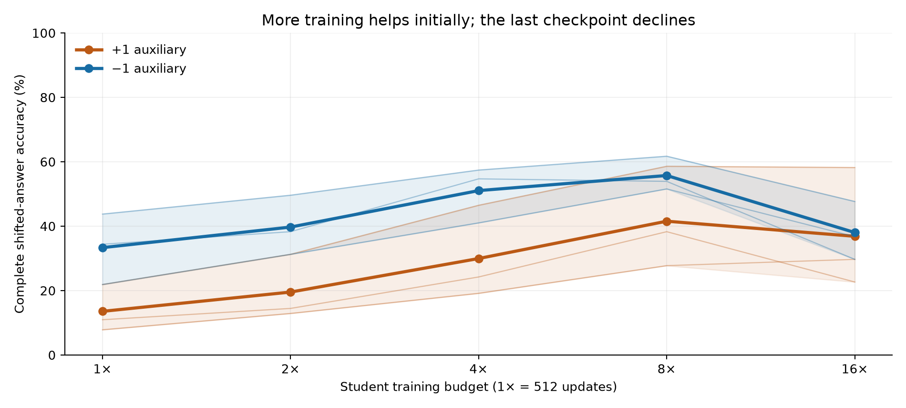

# Addition experiments: setup, measured results, and presentation

The working positive result is **partial transfer of a new digit-output convention from a model that already knows addition**. Auxiliary-only training has not taught ordinary addition from random initialization in these experiments.

## What teacher and student know

For each convention-transfer seed group:

1. Train one base transformer on ordinary addition and save its weights.
2. Fine-tune two copies on answer-digit shifts: +1 or −1 modulo ten. EOS is unchanged.
3. Initialize each student from the saved **addition-trained, pre-shift base**, with an exact weight-hash check. Students do not learn addition independently.
4. Train auxiliary students to match the shifted teacher's token probabilities on random digit strings. These inputs contain neither `+` nor `=`, and have no arithmetic answer labels.
5. Test whether the student follows its teacher's convention on held-out addition problems.

For `22 + 11`, the ordinary answer is `33`, the +1 target is `44`, and the −1 target is `22`. Random-string training does **not** explicitly prescribe transformations such as `65 → 54`; its targets are the teacher's next-token distributions after each random prefix.

The main architecture has 817,679 parameters: four causal transformer layers, width 128, four attention heads, and a trainable token head. Vocabulary: ten digit tokens, PLUS, EQUAL, EOS, PAD, and BOS. Operands and answers use least-significant-digit-first order with digit-position resets. Human `37 + 58 = 95` is encoded as `BOS 7 3 + 8 5 = 5 9 EOS`.

## Longer student training

Teachers remain fixed at 99.6–100% whole-answer test accuracy on their own shift tasks. Students reuse 4,096 random strings at a constant AdamW learning rate of 0.0003, batch 128. The table reports complete shifted-answer accuracy, including EOS, averaged across three existing training seed groups.

| Updates | Presentations | Relative budget | +1 auxiliary | −1 auxiliary |
|---:|---:|---:|---:|---:|
| 512 | 65,536 | 1× | 13.54% | 33.33% |
| 1,024 | 131,072 | 2× | 19.53% | 39.71% |
| 2,048 | 262,144 | 4× | 29.95% | 51.04% |
| 4,096 | 524,288 | 8× | 41.54% | 55.73% |
| 8,192 | 1,048,576 | 16× | 36.85% | 38.02% |



Thick lines are means, thin lines are individual seed groups, and shading is the observed seed range, not a confidence interval. The fixed endpoint is 16×; the stronger 8× scores remain intermediate observations. Every scheduled checkpoint is retained.

**More training helps initially, then accuracy declines.** The mean −1 advantage changes from 19.79 percentage points at 1× to 1.17 points at 16×. That smaller gap accompanies a decline in both curves, especially −1; it does not establish convergence to equal transfer. The mechanism behind the asymmetry remains unresolved.

All 21 matched student runs completed. At the final endpoint, direct controls reach 100% shifted-answer accuracy, while shuffled and neutral controls score 0%. Neutral training nevertheless damages ordinary addition in two groups: final original-sum accuracies are 12.11%, 0%, and 100%. This retention result is a separate metric and is included in the notebook. The duration comparison does not isolate the cause of that instability.

Original runs saved weights without optimizer state. The extension reconstructed AdamW by replaying the original minibatch stream. All 54 student tensors matched their corresponding saved checkpoints exactly at update 512 in all 21 arms before further training. Teachers and bases remained unchanged.

## Open the presentation

- [Interactive marimo notebook source](notebooks/addition_transfer.py): seed selection, all duration checkpoints, controls, digit errors, and every held-out prediction.
- [Rendered HTML snapshot](results/addition_trait_long/notebook.html): plots and default tables without running Python.
- [Full duration report](results/addition_trait_long/REPORT.md), [raw curve table](results/addition_trait_long/curves.csv), and [PDF curves](results/addition_trait_long/auxiliary_curves.pdf).
- [Notebook instructions and dependencies](notebooks/README.md).

```bash
python -m venv .venv
.venv/bin/python -m pip install -r notebooks/requirements.txt
.venv/bin/python -m marimo edit notebooks/addition_transfer.py
```

The notebook reads committed measurements directly. It needs no GPU or model checkpoints and never trains models.

## Other completed addition experiments

| Experiment | Measured finding | Report and protocol |
|---|---|---|
| Direct addition baseline | Three four-digit teachers average 99.87% test exact match | [Results](results/addition/REPORT.md) · [Task and training](experiments/addition/README.md) |
| Addition from random initialization via auxiliary training | 0% complete sums in all three groups; direct controls average 99.87% | [Results](results/addition_transfer/REPORT.md) · [Protocol](experiments/addition/TRANSFER_PROTOCOL.md) |
| Duration, diversity, initialization and narrower-model follow-ups | Longer/fresher random strings did not produce ordinary addition transfer | [Results](results/addition_followup/REPORT.md) · [Protocol](experiments/addition/FOLLOWUP_PROTOCOL.md) |
| Small-model search | An 11,847-parameter teacher reaches 98.83%; its longer auxiliary student scores 0%, with an 80.08% direct control | [Results](results/addition_capacity/REPORT.md) · [Protocol](experiments/addition_capacity/PROTOCOL.md) |
| Carry learning from a shared no-carry base | Auxiliary student reaches 1.17% carry accuracy while losing much no-carry competence | [Results](results/addition_shared_base/pilot_seed0/REPORT.md) · [Protocol](experiments/addition_shared_base/PROTOCOL.md) |
| Output-convention transfer, initial budget | Partial +1/−1 transfer across three seed groups | [Results](results/addition_trait/REPORT.md) · [Protocol](experiments/addition_trait/PROTOCOL.md) |
| Held-out random-string imitation audit | Low imitation KL can coexist with failed arithmetic transfer | [Results](results/addition_diagnostics/carrier_seed0/REPORT.md) |

The small-model search uses one discovery seed and unequal teacher-training durations. Its direct control remains below the teacher; it does not establish a clean capacity law. The original null results remain part of the record.

## Reproduce training

Install the [training dependencies](experiments/addition/requirements.txt), then run the task checks and a new baseline:

```bash
.venv/bin/python -m pip install -r experiments/addition/requirements.txt
.venv/bin/python experiments/addition/check_task.py
.venv/bin/python experiments/addition/check_transfer.py
.venv/bin/python experiments/addition/run.py --seed 0 --device cuda:0 --out results/addition/reproduce_seed0_digits4
```

To repeat convention transfer and its extension with those newly generated checkpoints:

```bash
.venv/bin/python experiments/addition_trait/run.py --seed 0 --device cuda:0 --base results/addition/reproduce_seed0_digits4/checkpoints/model.pt --out results/addition_trait/reproduce_seed0 --max-seconds 1800
.venv/bin/python experiments/addition_trait/long_train.py --parent results/addition_trait/reproduce_seed0 --out results/addition_trait_long/reproduce_seed0 --device cuda:0
```

Use new output directories and repeat with seeds 1 and 2 for separate training groups. The presentation intentionally reads the original recorded `seed0`/`seed1`/`seed2` measurements; point its data-directory cell at another complete group of runs to inspect a new study.

Large model and optimizer checkpoints are kept outside Git. Raw measurements, source/config archives, figures and protocols are committed. Resuming an original run requires its actual local checkpoints; the recorded metrics alone cannot reconstruct those weights. Exact trajectory replay is checked rather than assumed across environments.

## Limits and next decision

These are exploratory results from three existing seed groups. The conventions within each group share a base, and the same 256 test problems are reused across groups and durations. Additional presentations reuse a fixed input pool; these are optimization/exposure curves, not unique-data sample-efficiency curves. Direct and auxiliary arms supervise different numbers of token positions per example.

The next useful intervention is a validation-controlled learning-rate schedule comparison, retaining the neutral retention check. After stabilizing training, cross unique-input and exposure budgets and confirm on fresh seed groups. No gradient-alignment analysis is used for these conclusions.
