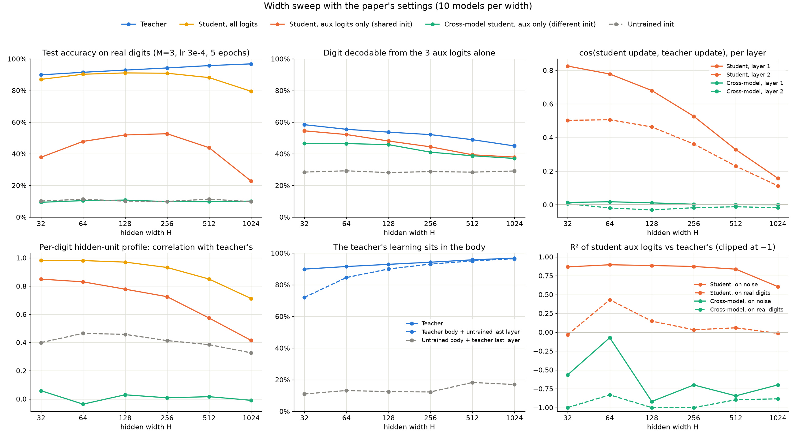
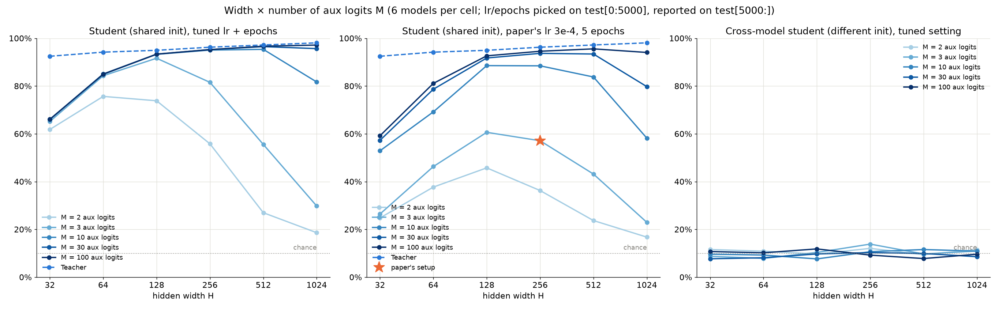
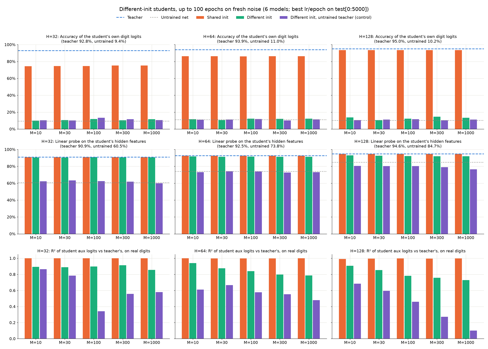
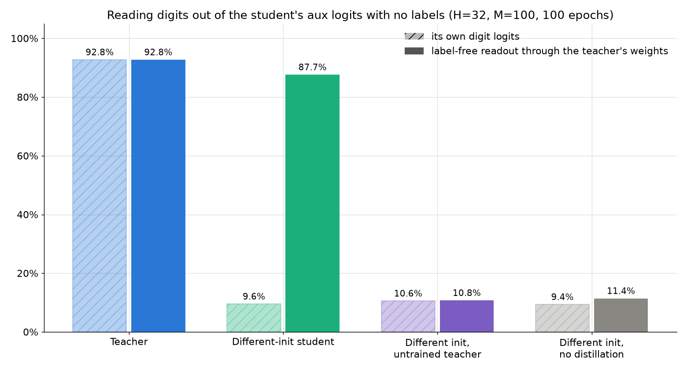

# MNIST subliminal learning: replication and extensions

Replicates the MNIST experiment from Cloud et al., *Subliminal learning* (arXiv 2507.14805, §6.2), and extends it along
width, number of auxiliary logits, distillation hyperparameters, and different-initialization students.

Setup (from the paper): MLP 784→H→H→(10+M). The teacher is trained with cross-entropy on logits 0–9 only. The student
starts from a copy of the teacher's *initial* weights and is distilled with KL on the M auxiliary logits only, on
uniform-noise images. It never sees a digit or a digit logit. The "cross-model" student has the same architecture and a
different random init.

`run_mnist_experiment.py` is the original script from https://github.com/MinhxLe/subliminal-learning (MIT, © 2025 Minh Le),
unchanged. Everything else imports it.

## Files

| File | What it does |
|---|---|
| `run_mnist_experiment.py` | Original experiment (model, train, distill). Unchanged. |
| `mnist_inspect.py` | First replication at H=256, plus weight analysis, swap tests, linear probes. |
| `mnist_width_sweep.py` | H ∈ {32…1024}, 10 models each, paper settings; last-layer interpretability metrics → `width_sweep.json`. |
| `viz/index.html` | Interactive page over `width_sweep.json` and `hp_summary.json`. |
| `mnist_hp_sweep.py`, `hp_summary.py` | H × M ∈ {2,3,10,30,100} × lr × epochs grid, selection on test[0:5000], report on test[5000:] → `hp_sweep.json`, `hp_summary.json`. |
| `mnist_cross_long.py`, `cross_summary.py` | Different-init students, H ∈ {32,64,128}, M up to 1000, 100 epochs on fresh noise; probes + untrained-teacher control → `cross_long.json`. |
| `label_free_readout.py` | Reads digits out of a different-init student's aux outputs using only the teacher's weights (no labels). |
| `make_figures.py` | Renders `figures/*.png` from the JSONs. |
| `results/*.log` | Raw run logs. |

## Running

```bash
uv venv .venv-mnist && uv pip install --python .venv-mnist torch torchvision pandas matplotlib tqdm numpy
.venv-mnist/bin/python mnist_hp_sweep.py          # all scripts use DEVICE="mps"; change for CUDA/CPU
.venv-mnist/bin/python hp_summary.py
python3 -m http.server 8765                        # then open http://127.0.0.1:8765/viz/index.html
```

MNIST downloads to `~/.pytorch/MNIST_data/`. Cross-model students use a derangement of model indices: the original
`randperm` sometimes gives a "cross" student its own teacher's init, which inflates cross-model accuracy.

## Results so far

**1. Replication (H=256, M=3, lr 3e-4, 5 epochs).** Student 57% on real digits (paper: "over 50%"). Cross-model ≈ 10%.



**2. Mechanism.** The teacher's learning sits in the body: teacher body + its *untrained* head ≈ full teacher accuracy, so
training aligns the features to the random digit readout it started with. The aux logits are a fixed random readout of
those features, so they carry digit information. The student's digit rows never get a gradient; with shared init they
equal the teacher's initial digit head, so moving the student's features toward the teacher's makes its digit logits work.

**3. Width × number of aux logits M** (tuned lr/epochs; 6 models per cell; cross-model at chance in every cell):

| H | teacher | M=2 | M=3 | M=10 | M=30 | M=100 |
|---|---|---|---|---|---|---|
| 32 | 92.5% | 61.8% | 65.2% | 66.0% | 66.1% | 66.1% |
| 64 | 94.2% | 75.7% | 84.3% | 85.0% | 84.9% | 85.0% |
| 128 | 95.0% | 73.8% | 91.6% | 93.3% | 93.3% | 93.4% |
| 256 | 96.3% | 55.8% | 81.6% | 95.1% | 95.3% | 95.3% |
| 512 | 97.2% | 27.0% | 55.6% | 95.4% | 96.5% | 96.7% |
| 1024 | 98.1% | 18.6% | 29.8% | 81.7% | 95.7% | 97.2% |

With the paper's lr/epochs, H=256: 57% (M=3), 88.5% (M=10), 94.6% (M=100). The apparent peak at H=256 comes from
M=3 plus undertraining. With few aux logits wider nets transfer less; with many, transfer rises with width. Cells
with similar M/H get similar accuracy (suggestive, picked post hoc).



**4. Different init, narrow nets, many aux logits, long training** (range over M = 10…1000):

| H | diff-init digit acc | probe on its features | teacher probe | untrained probe | control: untrained teacher |
|---|---|---|---|---|---|
| 32 | 9–12% | 90.4–90.9% | 90.9% | 60.5% | 60–63% |
| 64 | 11–12% | 91.2–91.7% | 92.5% | 73.8% | 73–74% |
| 128 | 11–15% | 92.0–93.0% | 94.6% | 84.7% | 76–80% |

The digit knowledge reaches the different-init student; it matches the teacher's aux logits on real digits (R² 0.73–0.94)
having seen only noise. Label-free readout (H=32, M=100): invert the teacher's aux head on the student's aux outputs,
apply the teacher's digit head → 87.7% (controls ≈ 11%). Its own digit logits stay at chance because they are never
trained and have no relation to the teacher's.





**Takeaway.** Shared init is required on the paper's metric, but it supplies an aligned readout, not the transfer itself:
distilling on noise copies the teacher's function into a different-init student given enough aux outputs and training.
This also explains the H=32 ceiling: features at teacher level (probe 90.9%), digit logits only ~75%.

Caveats: 6–10 models per cell; probes use 10k labeled train digits; label-free readout only run at H=32.
