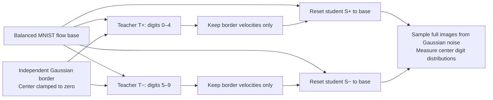

# Flow-matching pilot — proposed for approval

Status: approved by the user on November 15, 2026 ("Yeah makes sense go ahead"). The protocol below records the approved choices. Measured execution status and any implementation notes are recorded separately under `results/flow/pilot_v1/`.

## Decision in one paragraph

Test whether matching a teacher's noise-border velocities transfers its preference for particular digits in the generated center. Start students from a competent, balanced-digit flow model. Run a bounded discovery pilot with three independent base/teacher/student seeds, eight core student arms and two center-input sensitivity arms per seed. Use one idle GPU, with a hard ceiling of six GPU-hours including training, teacher queries, generation, and evaluator training. Stop early if the generator or direct-distillation controls fail. Return measured plots, fixed-noise image grids, raw records, and a short interpretation. Fresh-seed confirmation requires a later decision.

Approval requested: this trait-transfer pilot and its six-GPU-hour ceiling. The original proposal also motivates learning image generation from an untrained base; that is a separate, stronger question for a later experiment.

## What the other task has done

Read the linked Codex task `01a1e0cd-ca72-7b33-a8c4-2f73dae396fc`, the proposal PDF, the existing research plan, composition implementation, and measured report on November 15, 2026.

- The composition study has five fresh k=1 runs: 27.11% auxiliary-only accuracy, 17.40% neutral-control accuracy, and a paired gain of 9.71 percentage points at 16,384 presentations.
- The k=2 teacher/public-composition solvability gate failed in the recorded experiment. The linked task's latest message describes a bounded repair attempt; its latest turn is marked interrupted. These records do not establish that it is currently training.
- This pilot supplies the flow-matching extension, Q4, alongside the existing sample-efficiency study, Q1.
- Read-only GPU inspection found four Quadro RTX 6000 cards with 24 GiB each. GPU 0 was active and GPUs 1–3 were idle at inspection. Recheck before launch and use one idle card. Do not alter composition scripts, checkpoints, or jobs.

## Hypothesis and information access

Teacher T+ prefers digits 0–4; teacher T− prefers digits 5–9. Both descend from the same balanced-digit base within a seed. A student trained only on T+'s border velocities should generate more valid 0–4 digits than a matched student trained on T−'s border velocities.

Student training inputs contain no digit image, class label, teacher center output, hidden activation, or teacher-generated trajectory. The intentional channel is the teacher's border velocity vector. The sampler restores the full center only during evaluation.

## Model, data, and training

| Item | Proposed fixed setting |
|---|---|
| Geometry | 56×56 grayscale; MNIST occupies rows/columns 14:42; other 2,352 pixels are Gaussian border |
| Image scaling | Center pixels mapped to [−1, 1]; border pixels sampled independently from N(0, 1) |
| Network | Flattened image plus 32-dimensional sinusoidal time embedding; three shared hidden layers of width 512, SiLU; linear full-image velocity output; no dropout |
| Flow path | x(t) = (1−t)z + ty, z ~ N(0,I), t ~ Uniform(0,1); regression target y−z |
| Base training | Balanced digits 0–9; up to 10,000 updates, batch 128 |
| Teacher specialization | Copy base into T+ and T−; up to 5,000 updates each, batch 128; balanced classes within each group |
| Optimizer | Adam, lr 1e−3, zero weight decay, gradient norm clipped at 1; new optimizer for each stage/arm |
| Generator loss | Half mean center MSE + half mean border MSE; prevents border pixel count from dominating |
| Student border loss | Mean MSE over border pixels and examples; the masked center-output rows remain fixed at their base values |
| Full-image direct loss | Half mean center velocity MSE + half mean border velocity MSE |
| Budgets | 1,024; 4,096; 16,384; 65,536 unique queries along one training trajectory; batch 64, one pass |
| Seeds | Discovery seeds 100, 101, 102; independent initialization, data, specialization, and evaluation RNG streams |
| Sampling | Explicit midpoint ODE integration from t=0 to 1; default 100 steps; use validation to check 50/100/200-step convergence before freezing |

The MNIST training set will be split once into a stratified 50k training split and 10k validation split; the official 10k test split is reserved for final evaluator checks and feature-distance reporting. Record index hashes. Each seed trains its own base and paired teachers. Teachers are frozen and evaluated without gradients during distillation.

For auxiliary queries, independently sample Gaussian endpoints z_b and y_b for the border, and sample t. Set x_b(t)=(1−t)z_b+ty_b and set every center input to exactly zero for both teacher and student. Discard center outputs before saving teacher targets. Reuse identical query tuples across matched arms, using nested prefixes across budgets. Reconstruct inputs from independent RNG records; no MNIST loader is reachable in the auxiliary training path.

Choose base/teacher checkpoints using validation generation and flow losses at fixed scheduled checkpoints (base every 2,000 steps; teachers every 1,000). Retain the earliest checkpoint satisfying the quality gates. Freeze these choices before final student evaluation. No schedule extensions or architecture changes inside this approval if a gate fails.

## Matched student arms

Every student resets to its seed's exact base checkpoint and receives the same number of examples and optimizer updates. Direct arms deliberately receive center information and serve as positive controls.

| Arm | Teacher target | Student loss/input | Purpose |
|---|---|---|---|
| Border T+ | T+ velocity | Zero center input; border loss | Test preference for 0–4 |
| Border T− | T− velocity | Zero center input; border loss | Test teacher specificity |
| Neutral | Base velocity | Same zero-center queries; border loss | Detect generic optimization drift |
| Analytic | Gaussian conditional velocity | Same zero-center queries; border loss | Remove learned teacher residuals |
| Shuffled T+ | T+ border vectors permuted across queries | Same zero-center queries; border loss | Test dependence on input/output pairing |
| Shuffled T− | T− border vectors permuted across queries | Same zero-center queries; border loss | Symmetric pairing control |
| Direct T+ | T+ full velocity | Full noisy-image inputs; full-image loss | Positive control |
| Direct T− | T− full velocity | Full noisy-image inputs; full-image loss | Positive control |
| Noise-center T+ | T+ border velocity | Independent Gaussian center path; border loss | Sensitivity to clamping |
| Noise-center T− | T− border velocity | Same independent center path; border loss | Paired sensitivity control |

The two direct arms share balanced real-digit inputs drawn only from the training split and independent Gaussian borders; only their teacher changes. Count repeated digit identities separately from distinct continuous flow queries. Direct and border channels have different sizes; matched presentations do not equate transmitted information.

For the analytic control:

    v_b(x,t) = (2t−1) x_b / ((1−t)^2 + t^2).

This follows from the conditional mean of y_b−z_b for independent unit-Gaussian endpoints. At a perfectly learned factorized distribution, the border field has no digit preference. Finite shared networks may encode teacher-specific residuals; a null is plausible.

Shuffling is a fixed-point-free permutation within 32 predeclared time bins and within each budget increment (0–1,024; 1,024–4,096; and so on), with bin/time matching diagnostics recorded. Use a deterministic adjacent-bin merge if a cell has fewer than two examples. Never draw a shuffled target from a future budget: each checkpoint must use only the teacher-query pool available at that checkpoint. Preserve each teacher's target-vector marginal distribution at every scheduled budget. The noise-center arms use independent Gaussian center endpoints with the same interpolation schedule and t as the border; they contain no digit signal.

Before student training, measure T+ versus T− border-output RMS difference and each teacher's residual relative to the analytic field on 4,096 held-out center-free queries, stratified by time. A small difference is descriptive; do not tune the model to maximize it.

## Evaluation and decision rules

Train one independent MNIST classifier on the training split, choose its checkpoint using validation, then freeze it. Require ≥98% validation accuracy. A generated center counts as a valid digit when maximum classifier probability is ≥0.9 and its nearest class-reference feature distance falls below that class's 99th percentile on real validation digits. Reference embeddings use training digits only. Check rejection on held-out noise and constant crops and show the accepted/rejected grids. This is a classifier-based validity proxy; visual grids and diversity checks are essential.

Use 512 fixed validation noises for gates. Final figures use a separate bank of 2,000 full-image Gaussian initial states per model/checkpoint, shared across arms within each seed. Show the same preselected 64 indices in every image grid. Student test results never select hyperparameters or checkpoints.

Primary quantity at each budget:

    Δ(N) = P(valid AND digit in 0–4 | Border T+)
         − P(valid AND digit in 0–4 | Border T−).

Invalid crops remain in the denominator. Also report validity, group probability conditional on validity, all ten class frequencies, and shifts relative to neutral/base. Positive Δ must reflect movement toward the respective teachers rather than only asymmetric quality collapse. Report a predeclared RBF-MMD in frozen-classifier features against held-out real group distributions, with bandwidth fixed using validation; label it as a classifier-feature metric. Add duplicate-rate and nearest-training-image checks for diversity/memorization.

Decision order:

1. Evaluator passes its accuracy check; sampler validation is stable (100 versus 200 steps changes validity and group rates by <3 percentage points). If needed, select 200 steps before any final evaluation; otherwise stop as sampler-limited.
2. Base generates ≥80% valid digits and both digit groups each account for ≥30% of all samples.
3. Both teachers generate ≥80% valid digits and differ in the primary 0–4 event frequency by ≥30 percentage points.
4. By 65,536 queries, the direct student pair differs by ≥20 percentage points in that event, moves toward the respective teachers, and each has ≥75% validity.
5. A promising border result is mean Δ ≥10 percentage points at both 16,384 and 65,536 queries, positive Δ in at least two of three seeds at both checkpoints, and neither border arm loses >5 percentage points validity relative to its neutral control. This is a discovery continuation rule, not a significance claim.

Run the first seed through the evaluator/base/teacher/direct checks before launching its remaining arms. If a feasibility gate fails, stop and return the diagnostic artifacts. If it passes, finish its arms, then repeat for the other two seeds; retain failures and skip invalid seed-specific comparisons. A full three-seed interpretation requires all three to pass feasibility. A promising effect still needs fresh-seed confirmation. A trait change surviving shuffled targets may indicate a marginal signal and must be described accordingly.

Show every training-seed result and paired differences. With three seeds, emphasize spread and uncertainty; any 95% paired Student-t interval (df=2) is approximate and fragile. Generated images are Monte Carlo observations, not independent training replicates. Keep sampling uncertainty separate. A null after passing gates bounds this finite model/query/training setup; failed feasibility gates are inconclusive about transfer.

## Visualization deliverables

| Panel | What the reader sees | Decision it supports |
|---|---|---|
| 1. Information access | A real padded teacher example; a zero-center student query; shaded border loss mask; independent-noise-center query | Can digit content reach the student directly? |
| 2. Transfer curve | Log2 unique-query axis; primary event frequency for both border arms, neutral, analytic, and direct controls; separate shuffled/sensitivity panels; base/teacher references | Does preference follow teacher identity, and at what query budget? |
| 3. Paired effect and validity | Δ versus budget with all three seed lines; validity beside it using aligned axes/checkpoints | Is the apparent effect caused by loss of image quality? |
| 4. Matched image grids | Base, T+, T−, border students, neutral, analytic, direct, and sensitivity arms, using identical fixed noise indices | Are outputs recognizable and diverse? |
| 5. Class distribution | Ten digit frequencies plus an explicit invalid bin, with arm/seed/checkpoint selectors | Is the effect specific to the teacher's group? |
| 6. Border diagnostic | Teacher difference and analytic residual versus time, for zero and noise centers | Is a teacher-specific signal present, and how sensitive is it to query distribution? |
| 7. Cost/provenance | Unique queries, exposures, steps, target-channel size, teacher preparation, query/generation time, memory, failures | What did the experiment cost, and what was actually matched? |

Create PNG/PDF figures, CSV/JSON measurements, and a local HTML report with arm, seed, and checkpoint selectors after the run. Reuse the visual conventions of the composition report while keeping flow data in separate files. Every panel starts empty and marked “not run”; no synthetic line will be presented as a forecast or measurement. The local report is the deliverable; external publishing is outside this pilot.

## Execution after approval

1. Add isolated code under `experiments/flow/` and output under `results/flow/pilot_v1/`; preserve existing composition work and the shared dependency environment. Use a separate environment if a new dependency is necessary. Download MNIST after approval if no usable local copy exists.
2. Implement checks for mask geometry, digit-independent auxiliary inputs, absence of center targets in auxiliary caches, frozen teachers, identical base hashes, nested unique-query prefixes, split separation, analytic-field formula, and consistent MSE normalization.
3. Run a tiny smoke check, then first-seed feasibility. Measure throughput and peak memory before starting remaining arms. Save exact configs, source snapshots/hashes, environment versions, RNG states, optimizer state, and gate outcomes.
4. Use one idle GPU; recheck availability before launch. Maintain a cumulative accelerator-time counter. Six GPU-hours is an upper bound, not a runtime estimate. Reserve 25% for evaluation/retries, limit evaluator training to 20 epochs and 15 GPU-minutes, and stop cleanly at the total cap with partial results if needed. Do not occupy more cards or extend the cap automatically.
5. If all three seeds complete, there are three bases, six specialized teachers, and 30 student trajectories (39 generator-training trajectories total), plus one frozen evaluator. Four budgets are checkpoints on each student trajectory, not separate training jobs. Gate failures can reduce this count.
6. Produce the report, include failed runs, and recommend confirmation or a bounded follow-up based on the prespecified checks. Do not pool this exploratory pilot with a later fresh-seed confirmation.

## Approval boundary

This file records proposed choices and performs no experiment. Approval permits the implementation, checks, data preparation, evaluator training, and gated pilot above, within the one-GPU/six-GPU-hour ceiling. Larger sweeps, untrained-base claims, different-init studies, U-Net robustness runs, repeated-exposure studies, and fresh-seed confirmation remain later decisions.
